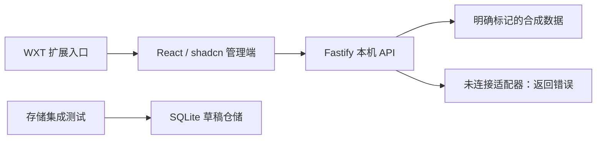

# 架构与实现边界

采用 pnpm workspace、独立 React Web 前端与 Node.js Fastify 后端。浏览器扩展是第三个可独立构建的应用。当前为单家庭本机初始化版本，后续设计支持同源、自托管、多端访问。

## 当前实现



- Web 使用 React 19、Vite 8、Tailwind 4、shadcn Base UI / nova、Lucide 和 TanStack Query。组件在 `apps/web/src/components/ui`，业务页面在 `features`，配置由 `components.json` 管理。
- Node 24、Fastify 5、REST JSON。生产静态页面和 API 同源；开发由 Vite 代理 `/api`。监听地址固定为 `127.0.0.1`。
- WXT / MV3 扩展当前仅打开本机网页，无官网权限、Cookie 权限、后台或内容脚本。未来的账号交接功能需独立规格。
- contracts 只包含公开 Zod DTO；domain 不依赖 HTTP 或数据库；tal-adapter 仅服务端使用，目前明确抛出未连接错误。
- db 使用 SQLite / better-sqlite3 / Drizzle，提供草稿增查、WAL、SQL 迁移和重启持久化；当前尚无草稿 HTTP 写接口。
- Vitest、Fastify inject 和 Playwright 只用合成数据。pnpm 锁文件固定依赖，GitHub Actions 执行规格、类型、测试、构建及公开内容检查。

当前数据库模块由源码直接运行，迁移目录与包一起维护；API 尚未加载数据库。后续接入数据库时需要为生产构建复制迁移并增加打包产物的持久化验收。

## 计划中的完整结构

```text
apps/web       页面、路由、查询缓存与表单
apps/api       认证、家庭、作业、草稿、附件、同步任务
apps/extension 官网会话交接辅助入口
packages/contracts   本系统 DTO 与错误码
packages/domain      日期、校验、同步状态机
packages/tal-adapter  端点、签名、官方业务错误归一化
packages/db          数据仓储和迁移
openspec             需求、设计、变更和验收任务
```

不生成空业务模块；按规格逐步添加。前端不得导入 tal-adapter、db 或服务端环境配置。React Hook Form / Zod 用于后续表单；API OpenAPI、登录 Cookie、附件与 Docker Compose 在对应功能中接入。

## 日期、存储与同步

外部家庭、孩子、设备和作业标识按不透明字符串处理。日期按 `Asia/Shanghai`，保存 `YYYY-MM-DD`；事件时间保存 UTC。草稿校验拒绝不存在的日期、空内容、未知科目和额外令牌字段。

SQLite 适合单实例家庭低并发部署，文件使用本地磁盘或容器本地卷，不经 SMB / NFS 被多端共同打开。后续附件内容存本地文件，元数据入库；Web 通过认证 API 访问。

未来同步记录应区分待发送、发送中、已确认成功、失败和结果未知。超时后先回读核对，不直接重复创建；“接口受理”和“学习机显示”分别验收。没有真实设备验收前不承诺可靠同步或定时无人值守。

## 会话与多端

本系统登录与学而思会话分离。目标是后端承担日常官方请求，多端网页只访问本系统会话，不接收官方令牌。先前探索支持这种方向，但协议未迁入公开实现。

未来会话默认只存后端内存；过期时显示需要重新连接。独立短信登录、自动续期、令牌加密持久化和 NAS 配对均未实现。远程交接不能沿用本机测试的授权与安全假设。

开放多端访问前实现本系统认证、HTTPS、HttpOnly / Secure Cookie、来源与 CSRF 校验。官方请求使用固定目的白名单、超时及重定向校验。日志不记录令牌、Cookie、验证码、私人响应或作业正文。

## 开发顺序

初始化 → 安全登录与只读接入 → 草稿编辑 → 单条文字提交及真机核对 → 图片与多端部署。每步通过 OpenSpec 定义场景，再以 TDD 实现，真实写入需要单独授权和验收。

## 开源材料

公开代码只用合成样例。`work/`、`outputs/`、`data/` 都是本机私有目录，不作为开源证据；不链接私人报告，不发布 APK、抓包、截图、厂商源码或协议私密常量。
